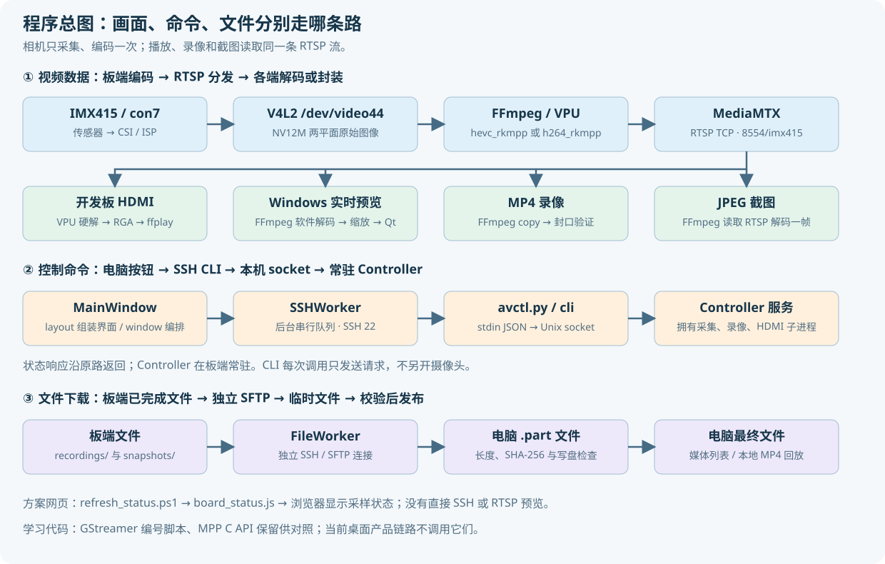

# 项目程序逻辑与目录导航

这份文档是现在的源码阅读入口。先理解三条链路，再按模块读代码。当前产品使用 **Windows 控制台 + 板端 FFmpeg / RK3588 VPU + MediaMTX**；MPP C API 和 GStreamer 代码保留用于学习与旧方案对照。

本轮只整理源码和文档，没有增加功能、更新已发布 EXE 或切换开发板程序。已有免安装包为已验收的 1.1.0；下面的模块划分对应本轮整理后的源码。

## 1. 先看整张图



三条链路互相配合，但承担不同任务：**RTSP 传画面，SSH 传操作，SFTP 传文件**。板端只有一个采集编码进程持有 `/dev/video44`；电脑预览、HDMI、录像和截图从 RTSP 获取内容。

## 2. 哪份代码才是修改源

| 项目位置 | 用途 | 修改原则 |
| --- | --- | --- |
| `board/ffmpeg_pipeline/` | 当前板端产品源码 | 板端功能在这里修改 |
| `desktop/` | Windows 桌面源码、依赖、测试、打包 | 电脑界面和控制在这里修改 |
| `docs/*.md` | 文档编辑源 | 编辑 Markdown，再生成同名 HTML |
| `tools/` | 文档生成、检查、源码交付与测试工具 | 用于开发与交付，不是常驻服务 |
| 根目录方案 HTML | 当前方案入口、文档链接、运行状态快照 | 保留现有文件名，方便本地打开 |
| `board/v4l2_mpp_enc/` | MPP C API 学习源码 | 与当前产品链路分开理解 |
| `board/00_…07_…sh` | 环境检查、原 GStreamer 方案 | 编号不表示当前 FFmpeg 启动步骤 |
| `音视频代码包/`、源码 ZIP | 自动生成的交付副本 | 从根目录源码重新生成，避免两份代码分别修改 |
| `desktop/dist/`、EXE ZIP | 已构建的桌面交付物 | 改源码不会自动改变已生成 EXE |
| `_work_desktop/`、`_work_ffmpeg/`、`backups/` | 本地验证材料和备份 | 不属于产品源码，不进入 GitHub |
| `evm3588_linux_v1.0.3/` | 厂商 SDK 和本地参考 | 本项目不把整个 SDK 上传 GitHub |

三个易混淆的路径：电脑的根目录 `board/` 是源码；`音视频代码包/board/` 是复制品；开发板的 `/userdata/av_dev/` 是部署位置。Windows 的 `C:\...` 不能在板端 Bash 中直接进入。

## 3. 启动入口有哪些

| 入口 | 执行位置 | 真正做什么 |
| --- | --- | --- |
| `desktop/main.py` 或已发布 EXE | Windows | 创建 Qt 应用、主窗口和后台工作线程 |
| `board/ffmpeg_pipeline/avctl.py` | 开发板 / SSH 会话 | 一次性 CLI：解析操作，把请求转给后台服务，返回 JSON |
| `avctl.py _serve` | 板端 systemd | 常驻控制服务，拥有 Controller 与采集、录像、HDMI 子进程 |
| `runtime/bin/mediamtx` | 板端 systemd | 接收编码发布，向多个读者分发 RTSP |
| `deploy.ps1` | Windows PowerShell | 上传源码，保留运行中的管线；不是直播启动器 |
| `refresh_status.ps1` | Windows PowerShell | 查询状态，生成本地 `board_status.js` 快照 |

只读查询示例，**开发板 Bash**：

```bash
python3 /userdata/av_dev/ffmpeg_pipeline/avctl.py status
```

解释：`python3` 执行统一 CLI；`status` 返回后台服务的实际运行状态，不重新打开摄像头。这个路径是开发板部署路径。

## 4. 桌面程序的阅读顺序

| 顺序 | 文件 | 重点 |
| --- | --- | --- |
| 1 | [main.py](../desktop/main.py) | 应用入口、版本、窗口启动 |
| 2 | [window.py](../desktop/evm_console/window.py) | 初始化、信号连接、按钮操作、状态回写、退出 |
| 3 | [layout.py](../desktop/evm_console/layout.py) | 首页和四个面板，控件如何绑定回调 |
| 4 | [core.py](../desktop/evm_console/core.py) | Connection、默认配置、按钮允许条件、JSON 和帧拼接 |
| 5 | [ssh.py](../desktop/evm_console/ssh.py) | 主机校验、串行操作、轮询、重连与会话编号 |
| 6 | [video.py](../desktop/evm_console/video.py) | FFmpeg 参数、完整帧、最新帧、看门狗与进程清理 |
| 7 | [files.py](../desktop/evm_console/files.py) | 独立 SFTP、路径约束、摘要、临时文件、下载取消 |
| 8 | [playback.py](../desktop/evm_console/playback.py) | 已下载 MP4 的本地回放窗口 |
| 9 | [widgets.py](../desktop/evm_console/widgets.py) | 外观样式、状态卡片、画面绘制 |

`layout.py` 只组装界面并连接回调，控件引用保存在 MainWindow 上。`window.py` 负责协调，不在按钮回调里做阻塞 SSH、SFTP 或视频解码。三个工作线程之间没有相互调用 Qt 控件；它们通过信号与主窗口通信。

## 5. 板端程序的阅读顺序

`avctl.py` 现在只保留入口。实现集中在 `camera_control/`，外部命令和 systemd 路径保持原样。

| 文件 | 输入 / 输出 | 责任 |
| --- | --- | --- |
| [cli.py](../board/ffmpeg_pipeline/camera_control/cli.py) | 命令参数、stdin JSON → 单行 JSON / 退出码 | 解析操作，不拥有硬件资源 |
| [transport.py](../board/ffmpeg_pipeline/camera_control/transport.py) | Unix socket 请求 / 响应 | 后台服务、单实例锁、请求调度、统一错误包装 |
| [config.py](../board/ffmpeg_pipeline/camera_control/config.py) | 配置字典 → 已校验配置 | 默认值、参数范围、ROOT、RTSP 地址和错误类型 |
| [controller.py](../board/ffmpeg_pipeline/camera_control/controller.py) | 操作请求 → 实际子进程与状态 | 采集、录像、HDMI、截图、参数恢复与监测 |
| [support.py](../board/ffmpeg_pipeline/camera_control/support.py) | 路径、设备节点 → 辅助结果 | 时间、日志、原子写入、占用检查、传感器帧率 |

Controller 保留集中式生命周期管理。采集、录像和 HDMI 的启停相互关联，统一拥有它们可以避免几个模块分别修改相同进程或锁。它仍是核心大模块，本轮先明确职责边界，而不是把状态拆散到互不协调的对象中。

## 6. 点击“连接开发板”后

1. MainWindow 收集地址、端口、用户名和认证方式；Connection 校验输入。
2. 按用户选择处理 Windows 凭据管理器；个人配置不保存明文密码。
3. SSHWorker 创建后台连接，核对已保存主机指纹；首次连接通过界面确认。
4. 连接成功后调用板端 `check`、`status`，查询编码器能力和现有运行状态。
5. 如果板端已有直播，VideoWorker 直接读取 RTSP；不会再启动第二个采集器。
6. FileWorker 使用独立连接列出已保存的录像和截图；控制和下载可以独立工作。

SSHWorker 没有操作时约每秒查询状态；执行操作时暂停叠加轮询。连接恢复后重新查询实际状态，不自动重复发送已经超时的启停或录像请求。

## 7. 点击“启动直播”后

1. `MainWindow.action()` 锁住重复点击，把 `start` 交给 SSHWorker。
2. SSHWorker 执行固定 CLI 命令。配置通过 JSON 标准输入传递，不拼进 shell 命令。
3. 板端 CLI 将请求发送到 `state/control.sock`；需要时启动相关 systemd 服务。
4. 服务用 `operation_lock` 串行处理会改变运行状态的请求。
5. `Controller.start()` 校验配置、录像保护、传感器帧率和旧状态；相同参数且直播已运行时直接返回状态。
6. `begin_capture()` 检查摄像头占用、MPP 编码器和 STREAMOFF 后的间隔，然后启动私有 FFmpeg。
7. FFmpeg 从 V4L2 取 NV12M 图像，使用 `hevc_rkmpp` 或 `h264_rkmpp` 硬编，向 MediaMTX 发布 RTSP。
8. 后台读取 FFmpeg `-progress`，结合 MediaMTX 就绪状态判定是否真正出流。桌面收到实际状态后接入画面。

H.265 压缩由 FFmpeg / MPP / VPU 承担，Python 层配置和管理进程。本项目的 NV12M 补丁解决采集兼容，保存在 `patches/`，与控制层分别维护。

## 8. 画面怎样来到电脑屏幕

VideoWorker 启动独立 Windows FFmpeg，通过 RTSP TCP 解码、按预览档位限帧缩放，输出 BGR24 到管道。FrameAssembler 根据宽×高×3 组装完整帧，处理一次读取不足一帧的情况。

后台只保留最新完整帧。主窗口定时取帧，由 VideoCanvas 绘制；显示来不及时丢弃旧画面，避免队列不断积累延迟。切换预览档位只重建电脑播放器，不改变原始直播、板端 HDMI 和 MP4 分辨率。

播放器进程与看门狗绑定当前代次。旧进程的帧和错误不能用于新的预览；出帧停滞或进程退出后自动恢复。界面区分板端编码帧率、电脑解码帧率和实际显示帧率。

## 9. 录像与截图怎样工作

**开始录像**：控制服务确认直播就绪、没有未关闭录像、剩余空间不少于 1 GiB；另起 FFmpeg 读取 RTSP，以 `-c:v copy` 写 `.partial.mp4`。它使用已编码码流，不做第二次视频编码。

**停止录像**：向录像进程发送正常退出信号，等待 MP4 封口；使用 ffprobe 验证视频与时长，再改成完成文件名，保存 `last-recording.json`。失败的临时录像保留用于排查，不作为已完成文件下载。

**截图**：另起短时 FFmpeg 从 RTSP 解码一帧，生成 JPEG；结果返回文件路径，桌面自动下载。它不再从 V4L2 打开相机。

**下载**：FileWorker 只接受录像/截图目录内的有效文件，读取板端 SHA-256，下载到 `.part`，核对长度、摘要和本地写入后再改名。同名本地文件也要内容相同才能复用；下载失败不覆盖已有最终文件。

**本地回放**：playback.py 使用电脑已下载的 MP4 和独立 VideoWorker，关闭回放不会修改板端录像或直播。

## 10. 修改编码参数、停止与退出

修改编码参数使用同一个 `start` 操作携带配置，不存在另一个隐藏配置接口。录像中拒绝变更；服务记录旧配置和 HDMI 意图，受控重启并等待新流。失败时尝试恢复旧直播，JSON 返回恢复是否成功，桌面读取实际状态再恢复预览。

“停止直播”先结束录像，再停止自身 HDMI 和采集子进程。Controller 不会为了抢摄像头自动终止无关程序。

“断开控制”或关闭桌面只释放电脑连接、播放器和下载；板端服务、直播及录像继续。异步退出保留 Qt 事件循环，直到工作线程退出，不在界面线程等待 12 秒阻塞。

## 11. 状态、接口和错误

| 板端状态 | 判定含义 |
| --- | --- |
| `stopped` | 没有采集进程，服务当前没有恢复采集的意图 |
| `starting` | 采集进程存在，尚未满足近期出帧和 RTSP 就绪条件 |
| `running` | 采集活着、有近期帧进度、MediaMTX 路径就绪 |
| `recovering` | 采集未活着，但仍有恢复直播的意图 |

SSH 连接、电脑播放、HDMI 和录像是独立维度，不能仅靠一个“在线”字段表达。`lastError` 是历史事件；当前恢复后的直播不应因旧错误一直显示失败。

CLI 返回 `ok` 和 `result`，失败时返回 `error`；参数恢复信息可能在 `result.recovery` 内。退出码 0 表示操作返回成功，1 表示失败。状态字段包括 `config`、`actualCapture`、`capturePid`、`encoder`、`vpuDeviceOpen`、`rtspReady`、`recording` 和帧进度。

| 操作名 | 作用 |
| --- | --- |
| `check` / `status` / `logs` | 能力、实际状态、最近日志 |
| `start` / `stop` | 启动或受控重配直播 / 停止直播 |
| `preview-start` / `preview-stop` | 板端 HDMI 读流播放器启停 |
| `record-start` / `record-stop` | 手动录像开始 / 正常封口结束 |
| `snapshot` | 从 RTSP 截图并返回保存路径 |
| `_serve` | systemd 内部入口，运行常驻控制服务 |

## 12. 线程、锁和文件所有权

| 对象 | 拥有什么 | 并发规则 |
| --- | --- | --- |
| Qt 主线程 | 窗口和控件 | 只在主线程操作控件，不做阻塞网络调用 |
| SSHWorker | 控制连接、串行任务队列 | 会话编号防止旧任务用于新连接；变更操作超时不重发 |
| VideoWorker | 电脑 FFmpeg、完整帧和最新帧邮箱 | 锁保护当前播放器；看门狗只针对自己的进程 |
| FileWorker | 独立 SSH/SFTP、下载取消 | 不借用控制连接；先临时文件后最终文件 |
| Controller | 板端采集、录像、HDMI 子进程 | `operation_lock` 串行变更；`lock` 保护共享状态 |
| monitor / read_progress | 监测与帧进度读取 | 在同一 Controller 上更新状态，不能创建第二个拥有者 |

只读请求不占 `operation_lock`，但读状态仍可能等待 Controller 的状态锁。单实例文件锁避免两个控制服务同时拥有管线。常驻服务通过 Unix socket 提供控制，MediaMTX 管理 API 仅监听板端本机。

## 13. 配置和数据存在哪里

| 位置 | 文件类型 |
| --- | --- |
| 板端 `config.json` | 当前采集编码参数；`config.example.json` 是提交到仓库的默认模板 |
| 板端 `runtime/` | 私有 FFmpeg、MPP/RGA 库、MediaMTX 与构建记录 |
| 板端 `state/` | 控制 socket、服务锁、状态快照、上次完成录像信息 |
| 板端 `logs/` | FFmpeg 采集、录像、HDMI 日志 |
| 板端 `recordings/` / `snapshots/` | MP4 与 JPEG |
| 电脑 `%LOCALAPPDATA%\EVM3588CameraConsole\` | 连接设置、主机指纹、日志和预览偏好 |
| Windows 凭据管理器 | 用户选择保存的密码或私钥口令 |
| 用户选定的电脑下载目录 | 已下载媒体和短时 `.part` |
| 根目录 `board_status.js` | 方案网页使用的手动采样快照 |

真实配置、凭据、媒体、运行快照、备份和构建产物不进入 GitHub。网页只显示采样状态，不是桌面软件控制入口，也不会在浏览器中直接连接 SSH 或播放 RTSP。

## 14. 改功能应定位哪里

| 想修改 | 首先读 / 改 | 需要同步检查 |
| --- | --- | --- |
| 按钮、布局、面板文案 | `desktop/evm_console/layout.py` | 回调仍连接 window.py，控件字段保持一致 |
| 按钮条件、错误反馈、操作顺序 | `window.py`、`core.py` | 服务实际状态、录像保护、信号回调 |
| SSH 行为与操作超时 | `ssh.py` | CLI / socket 超时和断线后状态核对 |
| 电脑预览尺寸、帧率、恢复 | `video.py` | 完整帧大小、代次与清理；不误改板端参数 |
| 下载和内容校验 | `files.py` | 目录限制、临时文件、取消与同名文件 |
| 录像、截图和采集生命周期 | `camera_control/controller.py` | FFmpeg 参数、封口、恢复、状态与互斥 |
| 参数范围和默认值 | `camera_control/config.py` | 桌面 core.py 与控件范围，二端不能各自随意扩大 |
| CLI / JSON 请求格式 | `cli.py`、`transport.py` | 桌面固定调用、操作指南、systemd 入口 |
| FFmpeg 采集兼容 | `patches/`、构建脚本 | NV12M stride、平面偏移、释放与硬件实测 |
| 文档和方案导航 | `docs/*.md`、方案 HTML | 生成 HTML、链接检查、源码交付副本 |

## 15. 开发时建议按这个顺序

1. 先确定修改属于界面、控制、视频、文件还是板端生命周期。
2. 追踪一个真实操作到最终响应，明确哪一层拥有状态。
3. 优先保持外部入口和 JSON 字段兼容；新增板端行为先验证接口，再加入界面。
4. 先跑不触碰直播的单元测试，再安排确实需要启停相机的硬件验证。
5. 最后更新文档、生成 HTML 和源码包；需要发布桌面软件时再单独构建 EXE。

**电脑 PowerShell，项目根目录**，运行桌面回归：

```powershell
.\.venv-desktop\Scripts\python.exe -m pytest .\desktop\tests -q
```

解释：使用独立虚拟环境的 Python；`-m pytest` 运行测试模块；路径选择桌面测试；`-q` 简洁输出。这些单元测试不会启停真实板端直播。

**电脑 PowerShell，项目根目录**，生成和检查文档：

```powershell
python .\tools\build_guide.py
```

解释：从 `docs/*.md` 生成对应 HTML。使用本机已有的 `markdown-it-py`；这是文档生成工具，不是桌面运行依赖。

```powershell
python .\tools\check_guide.py
```

解释：解析文档中的 Bash / PowerShell 命令并检查相对链接，不执行指南中的部署和启停命令。

实际操作与历史实测从 [文档导航](README.md) 继续阅读，本轮变更和验证见 [结构整理记录](项目结构整理记录.md)。
